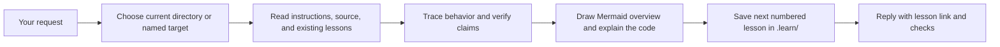

# Han Learn

`han-learn` helps you understand a project by tracing its actual code. It explains how the pieces work together, why the design is useful, and where to look when you want to make a change. Each request saves a source-linked Markdown lesson.

## When to use it

- You're new to a codebase and want a guided overview.
- You want to follow one feature from input to output.
- You have a focused question, such as why a component uses a particular pattern.

## How to use it

Open the project in Codex, then try:

```text
$han-learn
$han-learn how does authentication work?
$han-learn ./packages/api
```

By default, the current directory is the project target. Give a path to target a different project or package; relative paths start from the current directory. Lessons go in the target's `.learn/` folder as `001-...md`, `002-...md`, and so on. A focused question gets a shorter lesson and a direct answer in chat. Existing lessons are kept unless you ask to update one.

Each lesson begins with a Mermaid map of the project's architecture and flow, embedded in the saved Markdown file so GitHub renders it. The accompanying text and source links explain the flow too.

## How it works



The skill follows real entry points, data and state changes, and final output. It distinguishes observed behavior from inferred design reasons, checks source links and diagrams, and keeps application code untouched during teaching.

## Example output

From a lesson generated for a small CSV reporting project, after its opening Mermaid diagram:

```markdown
Ada's two `1.005` rows each round to `1.01`, so her total is `2.02`.
The calculation rounds each row before adding it to the customer's total.
See [core.py](../order_totals/core.py) for the rule and
[orders.csv](../orders.csv) for the input.
```

[Read the skill instructions](skills/han-learn/SKILL.md).
