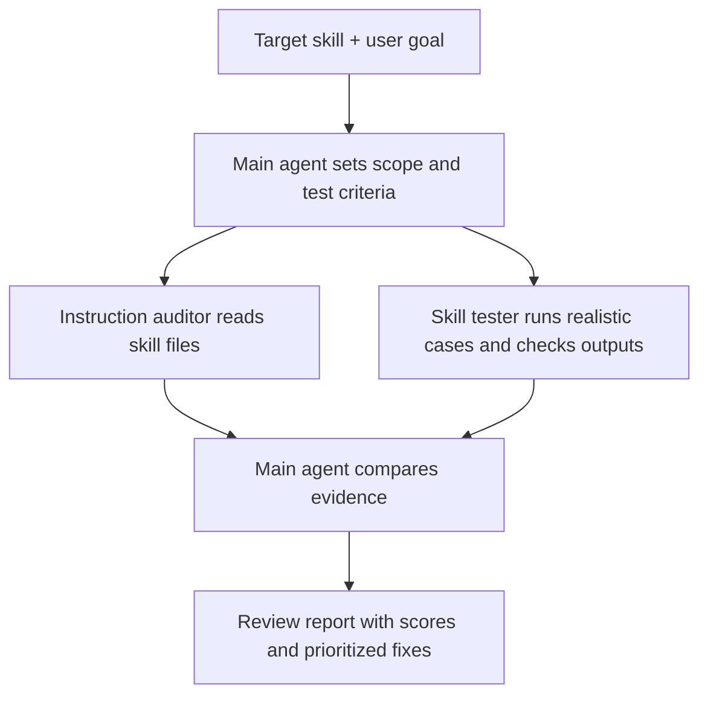

# Han Skills Review

`han-skills-review` checks whether an agent skill helps its users complete the job it promises. It reviews the instructions, tests the skill on realistic tasks when safe, then reports scores, findings, and practical fixes. It produces a review report; it changes the target skill only when you ask.

## When to use it

- You want to check a new skill before sharing it.
- A skill looks good on paper but gives weak or unreliable results.
- You want a prioritized list of improvements backed by examples.

## How to use it

In Codex, give it a skill name or a path to a skill folder or `SKILL.md`:

```text
$han-skills-review ./skills/han-learn
$han-skills-review "$han-learn"
$han-skills-review /path/to/another-skill/SKILL.md
```

It can also review skill text you paste into the chat. If the target is missing or unclear, it asks for the exact skill instead of guessing. For testing, it uses a disposable workspace when possible and keeps the original skill unchanged. If it cannot run the skill, the report says so and treats instruction-only scores as provisional.

## How it works



The auditor and tester work independently when subagents are available; the main agent judges their evidence. Otherwise, the main agent runs separate audit and test passes and labels that limit. The tester normally plans a typical case, a variation, and a failure case before running them. Scores cover usefulness, reliability, and completeness. If a test is interrupted, the reviewer checks what completed, makes one safe retry when appropriate, and reports any remaining gap.

## Example output

Excerpt from a review of `han-learn` on a sample project:

```text
Verdict: Ready within the tested scope — 88/100
Project overview: PASS — lesson created; source links resolve.
Focused question: PASS — rounding and error behavior match the code.
Missing target: PASS — no invented project or lesson.
Limit: Diagram source checked, but browser rendering was not tested.
```

[Read the skill instructions](skills/han-skills-review/SKILL.md).
